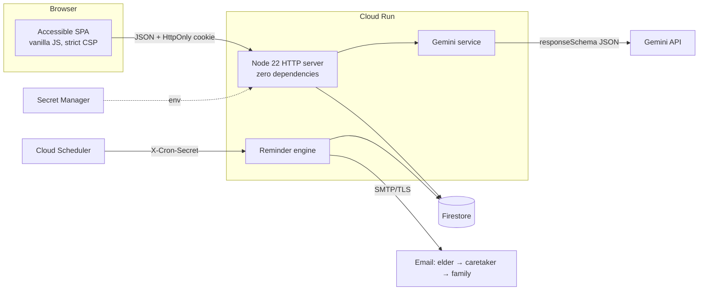

# SaathiCare — elder-first care circle

**SaathiCare** ("saathi" = companion) is a shared healthcare space for an elderly person, their family and their caretakers. It manages daily medicines, adherence and doctor appointments, sends **escalating email reminders**, and uses **Google Gemini** to read prescriptions, explain medicines in Indian languages, prepare doctor visits and write weekly family updates — while keeping **the elder in charge of their own healthcare decisions**.

> **Live demo:** _add your Cloud Run URL here_ · Demo circle **`DEMO42`**, passcode **`246810`** (choose "Fill as Kamala (elder)" or "Fill as Ravi (son)" on the landing page).

---

## Problem statement → implementation

| Requirement | How SaathiCare does it | Where |
|---|---|---|
| Shared ecosystem for elder, caretakers and family | A **care circle** per elder with roles `elder`, `caretaker`, `family`; up to 25 members | `server/routes/session.js`, `server/services/care.js` |
| Secure, **passcode-based access** | 6-digit passcode hashed with **scrypt** + random salt; constant-time checks; join rate-limited (5 / 15 min); same error for unknown circle or wrong passcode; signed HttpOnly `SameSite=Strict` session cookie; rotating the passcode signs out all other devices | `server/lib/security.js`, `server/routes/session.js` |
| View, add, edit, manage **medication schedules** | Full CRUD with multiple daily times, start/end dates, instructions, stock count, refills | `server/routes/medications.js`, `public/js/views/medications.js` |
| **Track adherence** | Per-dose check-in (tap, voice or on behalf of the elder), undo, 7-day adherence %, streaks, per-day chart with an accessible table | `server/services/schedule.js`, `server/routes/doses.js`, `public/js/views/insights.js` |
| Monitor **upcoming doctor appointments** | Appointment CRUD with countdown; next visit shown on the home screen | `server/routes/appointments.js` |
| Email reminders for **missed medications** | Escalation ladder: **elder** at dose time → **elder + caretaker** after 30 min → **caretaker + family** after 2 h | `server/services/reminders.js` |
| Email reminders for **upcoming doses** | "Time for your medicine" email 15 min before each dose | same |
| Email reminders for **appointments** | Everyone in the circle, **24 h** and **2 h** before | same |
| Go **beyond a reminder app** | Gemini prescription scan, multilingual medicine explainer, doctor-visit prep, weekly AI family digest, voice check-in, low-stock refill alerts | `server/services/ai.js` |
| **Elder at the centre** of decisions | Medicine changes from caretakers/family become **proposals** the elder approves or declines; elder controls settings, members and passcode; full **audit trail** of who did what | `server/routes/medications.js`, `public/js/views/circle.js` |
| More **accessible** | WCAG 2.1 AA: large type, 3 text sizes, high-contrast mode, 48–64 px targets, keyboard-only use, skip link, focus management, screen-reader live regions, status never by colour alone, voice input, reduced motion | `public/` |
| More **reliable** | Exactly-once reminders (atomic claim before send), outage lookback limit (no alert floods), Gemini retries with backoff, rules-based fallback when AI is unavailable, graceful shutdown, health check | `server/services/reminders.js`, `server/lib/gemini.js` |

## Google services used

| Service | Why |
|---|---|
| **Gemini API** (`gemini-2.5-flash`) | Vision prescription reading, multilingual explanations, doctor prep and digests, with JSON `responseSchema` outputs |
| **Cloud Run** | Serverless hosting for the single container (API + UI), scales to zero |
| **Cloud Firestore** | Durable storage via the REST API, authenticated with the Cloud Run service account (no key files) |
| **Cloud Scheduler** | Calls `/api/cron/reminders` every 5 minutes and `/api/cron/digest` weekly |
| **Secret Manager** | Session secret, cron secret, Gemini key and SMTP password, never in the repo |
| **Cloud Logging** | Structured JSON logs with `severity`, linked to the Cloud Trace request id |

## Architecture



**Why zero dependencies?** The entire app runs on Node 22 built-ins (`http`, `crypto`, `tls`, `zlib`, `fetch`, `node:test`). There are no third-party packages to audit for vulnerabilities, cold starts are fast, and the image is small.

### Project layout

```
server/
  index.js            entry point, graceful shutdown
  app.js              request pipeline: headers → rate limit → CSRF → auth → roles → body → handler
  config.js           validated env config
  seed.js             demo circle with a week of realistic history
  lib/                security, validation, HTTP/static, store (memory | Firestore REST), mailer (SMTP), Gemini client
  services/           time zones, scheduling & adherence, reminders, AI features, email templates
  routes/             session, circle, medications, doses, appointments, ai, cron
public/               index.html, styles.css, js/ (app shell + one module per screen)
tests/                106 tests: unit, integration (real HTTP), AI (mocked Gemini), SMTP, Firestore, accessibility
scripts/deploy.sh     one-command Google Cloud deployment
```

## Security

- Passcodes: scrypt hashing, constant-time compare, brute-force limit, no account enumeration, weak passcodes refused in production.
- Sessions: HMAC-SHA256 signed and expiring, HttpOnly, `SameSite=Strict`, `Secure` in production. Membership is re-checked on every request, so removing someone revokes their access immediately.
- CSRF: every state-changing request needs a custom header, which cannot be sent cross-site without a CORS preflight, and none is allowed.
- Authorization: every query is scoped to the caller's circle (tenant isolation is tested). Role checks protect elder-only actions.
- Input: strict schema validation on every body (unknown keys stripped), body size limits (64 KB, 6 MB for photos), JSON-only.
- Output: strict **Content-Security-Policy** (no inline scripts or styles, `frame-ancestors 'none'`), HSTS, nosniff, COOP/CORP. The UI renders all text with `textContent` and never uses `innerHTML`. HTML emails escape all values, and email headers are stripped of CR/LF.
- AI: user data is wrapped in `<data>` tags and marked untrusted in the system prompt; model output is re-validated and clamped. The AI never gives dosing advice and always includes a disclaimer.
- Secrets live only in environment variables or Secret Manager. `.env` is git-ignored.

## Accessibility

Semantic landmarks; skip link; one `h1` per view, which receives focus on navigation; `aria-current` navigation; native `<dialog>` modals (focus trap and Esc); labelled inputs with hints and inline errors (`aria-invalid`); `aria-live` toasts and `role="alert"` errors; text plus icons for status; three text sizes and a high-contrast theme saved per device; `prefers-reduced-motion`; voice check-in using the Web Speech API with a typed fallback; pinch zoom never disabled; print stylesheet for the doctor-visit sheet.

## Run locally

```bash
node --version          # 22+
cp .env.example .env    # optional: add GEMINI_API_KEY and SMTP settings
npm run dev             # http://localhost:8080 — demo circle DEMO42 / 246810
npm test                # 106 tests
npm run test:coverage   # ~98% line coverage
npm run lint
```

Without `GEMINI_API_KEY`, digest and doctor prep use a rules-based summary, and scan and explain show a friendly "not configured" message. Without SMTP, emails are logged in the **Care circle → Reminder emails** panel (demo mode).

Trigger the reminder engine by hand:

```bash
curl -X POST -H "X-Cron-Secret: dev-cron-secret" http://localhost:8080/api/cron/reminders
```

## Deploy to Google Cloud

```bash
export PROJECT_ID=your-project REGION=asia-south1
export GEMINI_API_KEY=...                         # from aistudio.google.com
export SMTP_USER=you@gmail.com SMTP_PASS=xxxx     # Gmail App Password (optional)
./scripts/deploy.sh
```

The script enables the APIs, creates Firestore, stores the secrets, deploys to Cloud Run and creates both Cloud Scheduler jobs.

## API summary

| Method | Path | Who |
|---|---|---|
| POST | `/api/circles` | anyone: create a circle |
| POST / GET / DELETE | `/api/session` | join with code + passcode / current session / sign out |
| GET | `/api/circle`, `/api/audit`, `/api/outbox` | members |
| PATCH | `/api/circle/settings` · POST `/api/circle/passcode` · DELETE `/api/members/:id` | elder |
| GET / POST / PATCH / DELETE | `/api/medications[/:id]` | members (non-elder changes become proposals) |
| POST | `/api/medications/:id/review` | elder |
| POST | `/api/medications/:id/refill` | members |
| GET | `/api/today` | members |
| POST / DELETE | `/api/doses`, `/api/doses/:id`, POST `/api/doses/voice` | members |
| GET / POST / PATCH / DELETE | `/api/appointments[/:id]` | members |
| POST | `/api/ai/scan-prescription`, `/api/ai/explain` · GET `/api/ai/digest`, `/api/ai/doctor-prep/:id` | members (rate limited) |
| POST | `/api/cron/reminders`, `/api/cron/digest` | Cloud Scheduler (secret header) |
| GET | `/api/health` | public |

## Disclaimer

SaathiCare supports care coordination. It is not a medical device and does not replace advice from a doctor or pharmacist.
